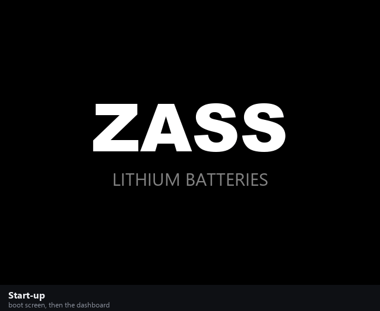

# ZASS MANTIS — Smart Battery Display & Logger

Display, safety-warning and data-logging unit for **ZASS lithium battery packs**, sold as the boxed
**ZASS SMART DISPLAY** (MANTIS board + 2.8" display).

It reads the battery management system (BMS) over **CAN** or **UART**, shows live values on the
display, warns the operator on screen and with a buzzer when a safety rule trips, and records
everything to an **SD card** with real-time timestamps.

<p align="center">
  
</p>

## Status

| | |
|---|---|
| Hardware | ✅ designed, first sample validated, all components automotive grade (AEC-Q100 / Q102) |
| −30 °C version | ✅ design done, **cold test at −30 °C passed** |
| Production | 🏭 50 units ordered, **plus 100 more units ordered** |
| Firmware `ZASS_MANTIS_115` | ✅ in this repository |

## Features

- **Dashboard** — charge level, voltage, current, highest and lowest battery temperature.
- **8 safety rules** — over-charge, over-discharge, cell imbalance, three temperature limits,
  communication loss, sensor fault. [Details →](docs/safety-rules.md)
- **Two BMS inputs** — CAN or UART, up to 25 cells; switches to UART automatically if CAN stops.
- **SD logging** — every cell voltage once a second plus a plain-language event log.
  Card can be hot-swapped. [Details →](docs/sd-logging.md)
- **Real-time clock** with backup battery, set from a text file on the SD card.
- **Self-recovery** — a firmware fault restarts the unit and the reason is logged; the last 127+
  events are also kept in on-board memory.

## What the display shows

[All screens with explanations →](docs/screens.md)

| Normal | Warning strip | Warning pop-up |
|---|---|---|
|  |  |  |

## Documentation

| Read this | To learn about |
|---|---|
| [Screens](docs/screens.md) | every display page and what triggers it |
| [Safety rules](docs/safety-rules.md) | the 8 rules, limits and delays |
| [SD logging and clock](docs/sd-logging.md) | file formats, setting the time |
| [Communication](docs/communication.md) | ports, speeds, CAN frames used |
| [Hardware](docs/hardware.md) | MCU, display, board revisions |
| [Firmware, tests, display project](docs/firmware.md) | modules, build, PC tests, regenerating the images |
| [User guide (PDF, Turkish)](docs/ZASS-SMART-DISPLAY-Kullanim-Kilavuzu.pdf) | two-page guide for customers |

## Repository layout

```
01_HARDWARE_ALTIUM/     Altium project (PCB1, PCB2), outputs
02_Firmware_STM32/      ZASS_MANTIS_115 firmware project + tests/
04_DWIN_DISPLAY/        display project (DWIN_SET goes on the display's SD card) + generator/
docs/                   documentation, screenshots, animation, user guide
```

---

**Türkçe özet:** ZASS MANTIS, ZASS lityum bataryalar için ekran, güvenlik uyarısı ve kayıt ünitesidir.
BMS verisini CAN ya da UART'tan okur, ekranda gösterir, 8 güvenlik kuralından biri oluşunca ekranda ve
buzzer ile uyarır, ölçümleri ve olayları tarih-saatiyle SD karta yazar. **−30 °C soğuk testi geçildi;
50 adetlik partiye ek olarak 100 adet daha sipariş verildi.** Müşteri kılavuzu:
[PDF](docs/ZASS-SMART-DISPLAY-Kullanim-Kilavuzu.pdf).
