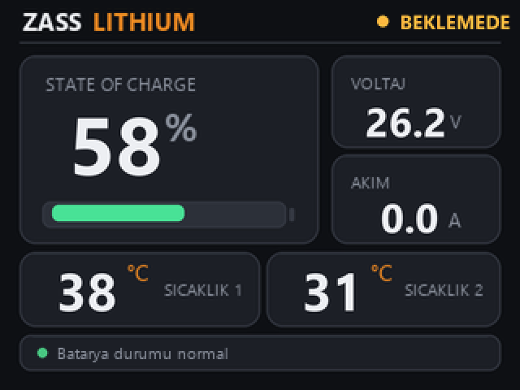
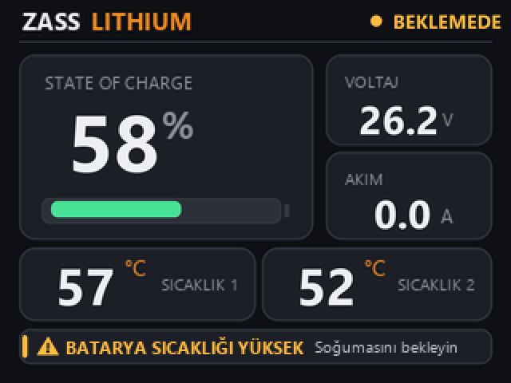
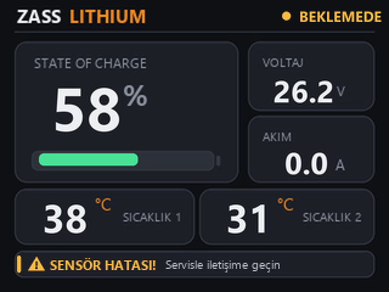
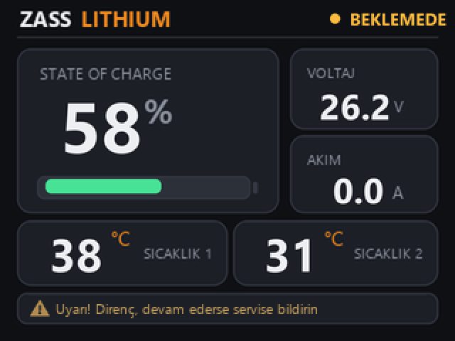
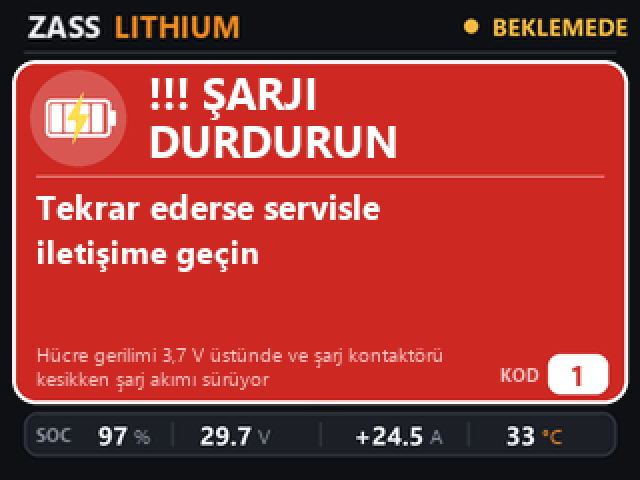
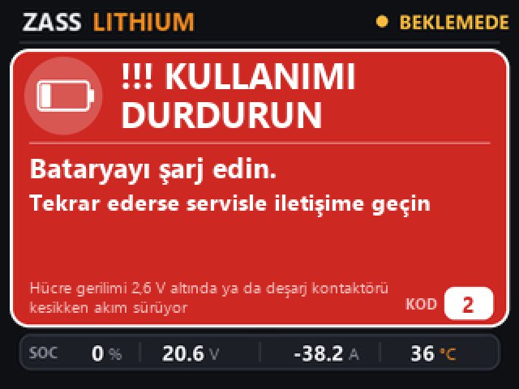
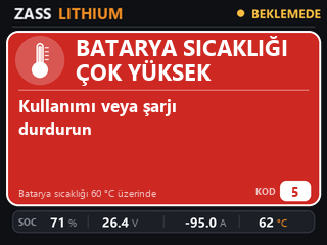
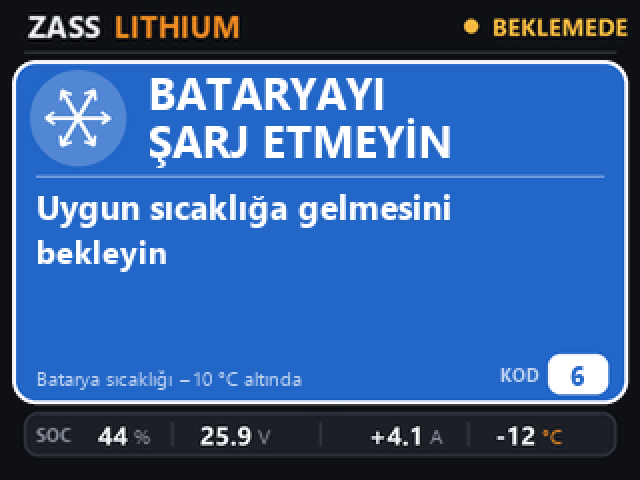
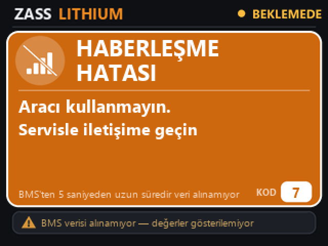

# Screens

The whole user interface is a single page (320 × 240). Warnings are drawn on top of it, so the live
values never jump around.

| Screen | When | Buzzer |
|---|---|---|
|  | **Main screen.** Everything normal. The strip at the bottom says "Batarya durumu normal" (battery status normal). `SICAKLIK 1` = highest, `SICAKLIK 2` = lowest battery temperature. | — |
|  | **Rule 4 — temperature above 55 °C.** Amber warning strip; the dashboard stays visible. | beep every 5 s |
|  | **Rule 8 — temperature sensor fault.** Fewer valid sensors than the pack should report, or no temperature data at all. | beep every 5 s |
|  | **Rule 3 — cell imbalance ≥ 0.3 V.** Dimmed advisory strip, shown for 15 minutes. | none |
|  | **Rule 1 — over-charge.** A cell is above 3.70 V and charge current keeps flowing although the BMS has opened the charge switch. Pop-up with blinking header; the bar underneath keeps showing live SOC / V / A / °C. | continuous |
|  | **Rule 2 — over-discharge.** A cell is below 2.60 V, or discharge current flows although the discharge switch is open. | continuous |
|  | **Rule 5 — temperature above 60 °C.** | continuous |
|  | **Rule 6 — temperature below −10 °C.** Do not charge. | continuous |
|  | **Rule 7 — no BMS data for 5 s.** Stale numbers are hidden instead of being shown as if they were live. | beep every 5 s |

When several warnings are active, the screen cycles through them every 4 seconds. Warnings clear
by themselves a few seconds after the condition has gone.

Temperature digits change colour with the same limits as the rules: blue at −10 °C and below,
white in the normal range, turning orange towards 55 °C and red at 60 °C.

[← Back to README](../README.md)
